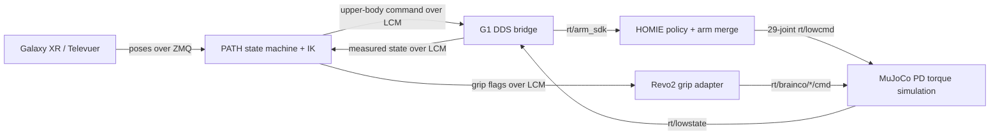

# MuJoCo simulation

The checked-in G1 model is loadable with its local mesh assets. The Revo2
variant, `mujoco/scene_29dof_with_revo2.xml`, is based on the integrated model
and MuJoCo adapter in `PATH-G1-main-rollback/sonic_runtime`. It contains the
29 G1 body actuators plus six commanded joints per Revo2 hand; five distal
joints per hand follow the model's coupling constraints. The scene loads as
`nq=58`, `nv=57`, `nu=41`.

For whole-body Galaxy XR teleoperation, run `bash scripts/setup_external_runtime.sh`
once, then `bash scripts/run_galaxy_homie_mujoco.sh`. Televuer and Unitree SDK
checkouts/installations live under `external/`, outside the source packages.
The launcher places DDS on loopback and uses an isolated same-host LCM
multicast URL so the simulated command stream does not join the normal G1
teleoperation group. Its Galaxy XR server starts tracking automatically once
valid controller poses arrive. Galaxy XR also needs a TLS certificate and key trusted by
the headset; set `PATH_TELEVUER_CERT` and `PATH_TELEVUER_KEY` if they are not at
`~/.config/xr_teleoperate/cert.pem` and `key.pem`.

HOMIE is the sole `rt/lowcmd` writer: it combines its leg/waist policy output
with PATH's 14 arm targets and gains. MuJoCo applies
`tau + kp * (q_des - q) + kd * (dq_des - dq)` to the 29 body actuators and
publishes simulated state back to DDS. The Revo2 adapter maps PATH's existing
binary left/right grip flags to the six normalized BrainCo command channels;
continuous hand tracking is not part of this PATH packet yet.

The simulation stack is adapted from PATH's Sonic runtime. Its declared
NumPy/SciPy versions are pinned in the `sim` extra; MuJoCo is pinned to 3.5.0,
the version installed in the reference PATH environment. PATH does not declare
exact Pinocchio or CasADi versions, so BOOST leaves those constraints
unversioned. See `configs/sim/mujoco_revo2.yaml` and
`configs/sim/homie_g1_mujoco.yaml` for model, hand, and HOMIE settings.
