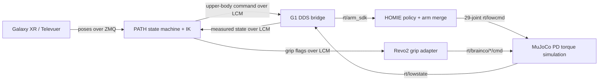

# MuJoCo simulation

The Revo2 variant, `mujoco/scene_29dof_with_revo2.xml`, uses official BrainCo
Revo2 hand geometry, inertias, and joint limits from the pinned
`external/brainco-description` submodule. BOOST adds the G1 wrist mounts,
six-channel actuators, and five distal-joint coupling constraints per hand.
The scene loads as `nq=58`, `nv=57`, `nu=41`.

Install and inspect the desktop environment with `pixi install -e sim` and
`pixi run -e sim setup-sim`, then launch the complete HOMIE/PATH/Galaxy XR stack
with `pixi run -e sim mujoco`. Use `pixi run -e sim mujoco-no-xr` to bring up
MuJoCo, HOMIE, and PATH without a headset, or `pixi run -e sim mujoco-headless`
to run without XR or a viewer. Pixi installs Televuer and Unitree SDK2 Python
from pinned Git revisions; the desktop setup script initializes the BrainCo
description submodule. The local LCM/DDS relay is Python and follows the
existing PATH packet and Unitree DDS contracts, so the desktop setup does not
require a native SDK checkout or C++ build.

The headless stack starts, but HOMIE waits for its START/controller input. In a
desktop-only run with no controller event, the G1 model drops to the floor;
the next simulation bring-up task is a repeatable stand/hold input and stable
startup check. This is separate from the Revo2 retargeter path.

The launcher places DDS on loopback and uses an isolated same-host LCM
multicast URL so the simulated command stream does not join the normal G1
teleoperation group. Galaxy XR requires a TLS certificate and key trusted by
the headset; set `PATH_TELEVUER_CERT` and `PATH_TELEVUER_KEY` if they are not at
`~/.config/xr_teleoperate/cert.pem` and `key.pem`.

HOMIE is the sole `rt/lowcmd` writer: it combines its leg/waist policy output
with PATH's 14 arm targets and gains. MuJoCo applies
`tau + kp * (q_des - q) + kd * (dq_des - dq)` to the 29 body actuators and
publishes simulated state back to DDS. PATH's existing adapter maps binary
left/right grip flags to the six normalized BrainCo command channels. The new
`boost/control/hand_mppi` module exposes that same six-channel DDS contract for
continuous Revo2 targets. Televuer supplies 25 tracked hand joints, and the
Galaxy XR path now forwards those points over its existing ZMQ pose message.
The low-level Revo2 retargeter runner still needs to consume them and publish
the six DDS targets.

The simulation stack is adapted from PATH's Sonic runtime. The `sim` Pixi
environment uses the pinned MuJoCo/PATH Python dependencies declared in the
project's `sim` extra. See `configs/sim/mujoco_revo2.yaml` and
`configs/sim/homie_g1_mujoco.yaml` for model, hand, and HOMIE settings.
