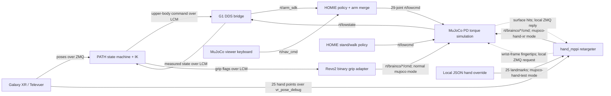

# MuJoCo simulation

The Revo2 model uses official BrainCo Revo2 hand geometry, inertias, and joint limits from the pinned
`external/brainco-description` submodule. BOOST adds the G1 wrist mounts,
six-channel actuators, and five distal-joint coupling constraints per hand.
The original vacant scene, `mujoco/scene_29dof_with_revo2.xml`, loads as
`nq=58`, `nv=57`, `nu=41`.

The active scene in `configs/sim/mujoco_revo2.yaml` is
`mujoco/scene_29dof_with_revo2_table_room.xml`: it combines the G1/Revo2 model
with the `table_room_1x3450` room and the articulated `cardboard_box_0002`
MuJoCo model. The articulated box and the room's original Pringles can both sit
on the 0.80 m tabletop. The box retains its four limited flap hinges. The
contact query targets the box body, its four flap collision geoms, and the can's
cylinder collider. The vacant scene remains available using
`configs/sim/mujoco_revo2_vacant.yaml`:

```bash
MUJOCO_SIM_CONFIG=configs/sim/mujoco_revo2_vacant.yaml pixi run -e sim mujoco-hand-test
MUJOCO_SIM_CONFIG=configs/sim/mujoco_revo2_vacant.yaml pixi run -e sim mujoco-hand-xr
```

The room places its table 3.25 m ahead of the robot spawn. The MuJoCo viewer
keyboard sends local `rt/nav_cmd` velocities to HOMIE so the simulated G1 can
walk to the table in both interactive test and teleoperation runs.
Asset sources and the local scene adaptations are listed in
[`mujoco/assets/ASSET_SOURCES.md`](mujoco/assets/ASSET_SOURCES.md).
The previous `cardboard_box_0001` model files remain under
`mujoco/assets/articulated_boxes/cardboard_box_0001/`.

Install and inspect the desktop environment with `pixi install -e sim` and
`pixi run -e sim setup-sim`. Use `pixi run -e sim mujoco-hand-test` to start
MuJoCo, HOMIE's stand/walk policy, and Revo2 hand MPPI from an editable JSON
landmark file. At zero keyboard command HOMIE selects `stand.onnx`; pressing a
movement key selects `walk.onnx`. It starts no Galaxy XR, Televuer, or PATH
process, so it is the local hand-MPPI test route. Use
`pixi run -e sim mujoco-hand-xr`
for the separate live Galaxy XR → Televuer → PATH → Mimic → Revo2 loop. That
launcher starts the existing PATH/XR stack and disables PATH's binary grip DDS
writer while MPPI is active. In this mode it also starts a local MuJoCo surface
query endpoint for the contact-guided hand targets. Set the manipulated object's
collision geom names in `configs/sim/mujoco_revo2.yaml` under
`surface_query.object_geom_names`; the active scene already names the articulated
box's five colliding surfaces. The standard `mujoco`, `mujoco-no-xr`, and
`mujoco-headless` tasks remain available for the original PATH setup.
Both MPPI routes use the separate Pixi `hand` environment.
Pixi installs Televuer and Unitree SDK2 Python from pinned Git revisions; the
desktop setup script initializes the BrainCo description submodule. The local
LCM/DDS relay is Python and follows the existing PATH packet and Unitree DDS
contracts, so the desktop setup does not require a native SDK checkout or C++
build.

The MPPI test task ramps HOMIE to its configured default pose and starts with
`cmd_vel=[0,0,0]`. Its default curled-hand override is
`configs/hands/revo2_hand_override_fist.json`; an open-hand pose is also
available in `configs/hands/`. Pass `--override-file PATH` or set
`MUJOCO_HAND_OVERRIDE_FILE` to select another pose. The runner reloads the
selected JSON file while active, so it can be changed to exercise different hand
poses. The procedure and fillable record are in
[`docs/test_logs/mujoco_homie_hand_mppi.md`](../../docs/test_logs/mujoco_homie_hand_mppi.md).

With the viewer focused, W/S set forward/backward velocity, A/D set left/right,
and Q/R set left/right yaw. O/P lower/raise a shared speed scale from 20% to
100% in 10% steps. Direction inputs stay active until the opposite direction
or Space is pressed. The initial scale is 50%; the viewer overlay and periodic
sim log show the current `cmd_vel`.

The launcher places DDS on loopback and uses an isolated same-host LCM
multicast URL so the simulated command stream does not join the normal G1
teleoperation group. The XR launcher reuses `PATH_TELEVUER_CERT` and
`PATH_TELEVUER_KEY` when they point to readable files, or creates a default
self-signed pair at `~/.config/xr_teleoperate/cert.pem` and `key.pem`. The
headset may need to trust/import that certificate before connecting.
For the Galaxy XR URL, startup/shutdown commands, and occupied-port cleanup,
see the [MuJoCo + Galaxy XR runbook](../../docs/mujoco_galaxy_xr_runbook.md).



HOMIE is the sole `rt/lowcmd` writer: it combines its leg/waist policy output
with PATH's 14 arm targets and gains. MuJoCo applies
`tau + kp * (q_des - q) + kd * (dq_des - dq)` to the 29 body actuators and
publishes simulated state back to DDS. PATH's existing adapter maps binary
left/right grip flags to the six normalized BrainCo command channels. The
`boost/control/hand_mppi` runner consumes either Televuer's 25 landmarks from
the existing `vr_pose_debug` ZMQ message or an editable local JSON pose, runs
Mimic's sampling-based retargeter against BrainCo's official Revo2 hand model,
then publishes six normalized DDS targets. Both MPPI launchers disable the
binary grip publisher so only one process writes the Revo2 command topics.

The simulation stack is adapted from PATH's Sonic runtime. The `sim` Pixi
environment uses the pinned MuJoCo/PATH Python dependencies declared in the
project's `sim` extra. See `configs/sim/mujoco_revo2.yaml` and
`configs/sim/homie_g1_mujoco.yaml` for model, hand, and HOMIE settings.
