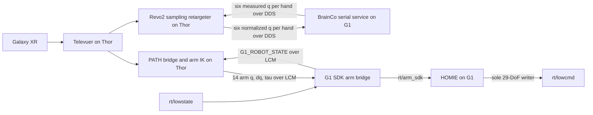

# Control ownership

<<<<<<< HEAD
BOOST keeps PATH's Galaxy XR arm teleoperation and IK. On G1, its 14 arm targets travel in the PATH PDU1 packet over LCM, then the G1 adapter publishes `rt/arm_sdk`. The DreamWaQ runtime reads that topic together with `rt/lowstate` and is the only hardware process that publishes `rt/lowcmd`.

| Joint/device group | Target producer | Final path |
| --- | --- | --- |
| 12 exported lower-body joints | Selected DreamWaQ export | DreamWaQ `rt/lowcmd` writer |
| Waist/spine | Export manifest action compiler and target config | DreamWaQ `rt/lowcmd` writer |
| Left/right arms, motors 15–28 | PATH nonlinear IK | `rt/arm_sdk` → DreamWaQ merge → `rt/lowcmd` |
| G1 state | Unitree DDS | `rt/lowstate` → DreamWaQ; G1 adapter also relays GST1 over LCM |
| Physical G1 cameras | Teleimager | TIM2/ZMQ → Thor relay → wrist-image LCM |
| Revo2 hands in MuJoCo | BOOST binary grip adapter or hand MPPI, one at a time | Simulated BrainCo DDS channels |

The G1 bridge publishes arm targets and relays state. It does not publish `rt/lowcmd`. `g1_ws/g1_lowlevel_bridge` is not part of the live command path: even its null-action smoke mode publishes `rt/lowcmd`, so it must not run next to DreamWaQ. The GCA1 `G1_POLICY_ACTION` packet is a separate 29-joint policy format; it does not replace PATH's PDU1 `G1_PATH_UPPER_COMMAND` packet.

```text
Galaxy XR → PATH IK → PDU1/LCM → G1 adapter → rt/arm_sdk ─┐
                                                          ├→ DreamWaQ → rt/lowcmd → G1
G1 rt/lowstate ───────────────────────────────────────────┘

Galaxy XR hand input → existing BOOST Revo2/MPOPI path → simulated Revo2

G1 Teleimager TIM2/ZMQ → Thor relay → pose service / RGB SAM3 path
```

The MuJoCo backend runs the same DreamWaQ policy and action compiler directly inside the simulator loop. It reads MuJoCo state and PATH adapter `rt/arm_sdk` targets, applies target PD gains and actuator torque limits, and never subscribes to or publishes hardware `rt/lowcmd`.

See [`dreamwaq_integration.md`](dreamwaq_integration.md) for installation, launch commands, protocol details, and selected export provenance.
=======
The physical teleoperation stack splits G1 body control from the external
BrainCo Revo2 hand controllers. Thor owns operator-facing computation and
publishes arm and hand targets through separate channels. HOMIE on the G1 owns
the final 29-DoF body command.

| Joint/device group | Target producer | Final command path |
| --- | --- | --- |
| G1 legs, motors 0-11 | HOMIE policy on G1 | HOMIE merged `rt/lowcmd` |
| G1 waist, motors 12-14 | HOMIE policy on G1 | HOMIE merged `rt/lowcmd` |
| G1 arms, motors 15-28 | PATH nonlinear IK on Thor | `G1_PATH_UPPER_COMMAND` LCM → G1 arm bridge → `rt/arm_sdk` → HOMIE → `rt/lowcmd` |
| BrainCo Revo2 hands, six joints per side | Mimic sampling retargeter on Thor | Unitree DDS `rt/brainco/{left,right}/cmd` → G1 BrainCo serial service |
| Revo2 measured state | G1 BrainCo serial service | Unitree DDS `rt/brainco/{left,right}/state` → Thor hand runner |
| Robot state | G1 arm bridge | `rt/lowstate` → `G1_ROBOT_STATE` LCM → Thor PATH IK |

HOMIE is the sole publisher to `rt/lowcmd`. The G1 bridge publishes only the
14 arm targets to `rt/arm_sdk`; it does not write body low-level commands or
Revo2 DDS. Revo2 has its own actuator electronics and serial-to-DDS service, so
its six-joint commands do not belong to the G1 29-motor `rt/lowcmd` array.



Fresh arm IK results and fresh Revo2 retarget results pass through without
moving averages, output interpolation, or post-solver rate limiting. Input
timestamps, finite values, and model joint limits remain checked. PATH passes
the fresh Cartesian goal unchanged into IK by default; shared perception/contact
targets are disabled unless explicitly enabled with
`PATH_ENABLE_SHARED_TARGET_ASSIST=1`. IK does not project an unreachable goal
toward the current pose. Residuals are diagnostics and do not discard a finite
in-bounds solution. When a command stream becomes stale, its publisher stops
issuing new targets; the receiving controller or hand service applies its
configured watchdog behavior.

Use the local `homie_g1_29dof` deployment for the arm merge. Do not run another
`rt/lowcmd` publisher at the same time. See
[`homie_integration.md`](homie_integration.md) and the staged bring-up in
[`g1_installation.md`](g1_installation.md).
>>>>>>> 228019f83417f222bc20e79b837865e645492e13
