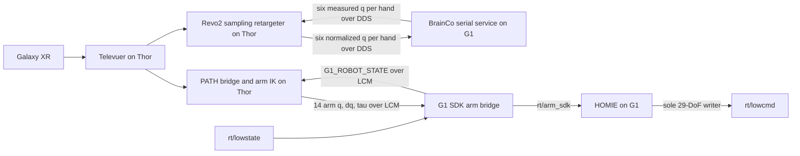

# Control ownership

The physical teleoperation stack splits G1 body control from the external
BrainCo Revo2 hand controllers. Thor owns operator-facing computation and
publishes arm and hand targets through separate channels. HOMIE on the G1 owns
the final 29-DoF body command.

| Joint/device group | Target producer | Final command path |
| --- | --- | --- |
| G1 legs, motors 0-11 | HOMIE policy on G1 | HOMIE merged `rt/lowcmd` |
| G1 waist, motors 12-14 | HOMIE policy on G1 | HOMIE merged `rt/lowcmd` |
| G1 arms, motors 15-28 | PATH nonlinear IK on Thor | `G1_PATH_UPPER_COMMAND` LCM → G1 arm bridge → `rt/arm_sdk` → HOMIE → `rt/lowcmd` |
| BrainCo Revo2 hands, six joints per side | Mimic sampling retargeter on Thor | Unitree DDS `rt/brainco/{left,right}/cmd` → G1 BrainCo serial service |
| Revo2 measured state | G1 BrainCo serial service | Unitree DDS `rt/brainco/{left,right}/state` → Thor hand runner |
| Robot state | G1 arm bridge | `rt/lowstate` → `G1_ROBOT_STATE` LCM → Thor PATH IK |

HOMIE is the sole publisher to `rt/lowcmd`. The G1 bridge publishes only the
14 arm targets to `rt/arm_sdk`; it does not write body low-level commands or
Revo2 DDS. Revo2 has its own actuator electronics and serial-to-DDS service, so
its six-joint commands do not belong to the G1 29-motor `rt/lowcmd` array.

Fresh arm IK results and fresh Revo2 retarget results pass through without
moving averages, output interpolation, or post-solver rate limiting. Input
timestamps, finite values, and model joint limits remain checked. PATH passes
the fresh Cartesian goal unchanged into IK by default; shared perception/contact
targets are disabled unless explicitly enabled with
`PATH_ENABLE_SHARED_TARGET_ASSIST=1`. IK does not project an unreachable goal
toward the current pose. Residuals are diagnostics and do not discard a finite
in-bounds solution. When a command stream becomes stale, its publisher stops
issuing new targets; the receiving controller or hand service applies its
configured watchdog behavior.

Use the local `homie_g1_29dof` deployment for the arm merge. Do not run another
`rt/lowcmd` publisher at the same time. See
[`homie_integration.md`](homie_integration.md) and the staged bring-up in
[`g1_installation.md`](g1_installation.md).
