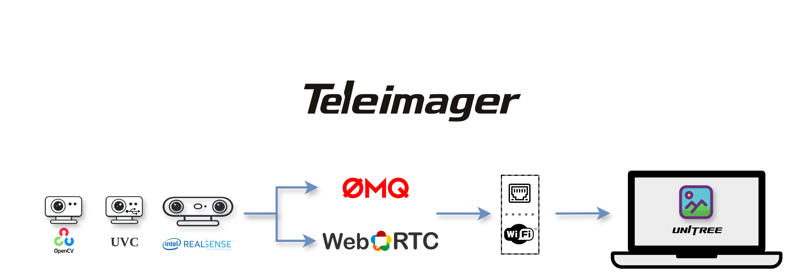

<div align="center">
  
  <a href="https://www.unitree.com/" target="_blank">
    
  </a>
  <p align="center">
    <a> English </a> | <a href="README_zh-CN.md">中文</a>
  </p>
</div>
<p align="center">
  <a href="https://github.com/unitreerobotics/xr_teleoperate/wiki" target="_blank"> </a> <a href="https://discord.gg/ZwcVwxv5rq" target="_blank"> <a href="https://deepwiki.com/unitreerobotics/teleimager"></a> </a>
</p>

## 0. URL Usage

Camera servers default to logical CPUs **0 and 1**, including all existing
threads and child processes. Native libraries and workers inherit this mask
because the CLI applies it before importing the camera stack. No separate
partition command is needed for `teleimager-server`, `python -m
teleimager.image_server`, or `groot_deploy/run_nature_camera.sh`. This keeps
cameras off the G1 DreamWaQ CPU 6, control CPU 7, DDS I/O CPUs 3–5, and the
existing SLAM CPUs 2–3. Use `--camera-cpus 0,1` for an explicit override;
`--no-affinity` explicitly disables isolation. Remove `--no-affinity` from old
camera commands when using the G1 control loop.

This section is the recommended setup for the teleimager copy vendored in
`url_g1_deploy`, using an HBVCAM-4M2214HD-2 V11 side-by-side stereo camera.

### 0.1 Install

```bash
conda create -n teleimager python=3.10 -y
conda activate teleimager

sudo apt update
sudo apt install -y libusb-1.0-0-dev libturbojpeg0-dev v4l-utils psmisc

cd ~/url_g1_deploy/thirdparty/teleimager
pip install -e ".[server]"
```

`v4l-utils` provides `v4l2-ctl`; `psmisc` provides `fuser`.

For the OpenCV backend, the user must be able to read `/dev/video*`. If access
is denied, add the user to the `video` group and log in again:

```bash
sudo usermod -aG video "$USER"
```

The optional `setup_uvc.sh` also configures raw USB permissions for the UVC
backend and permission to reload `uvcvideo`. It changes system udev and sudoers
configuration, so use it only on the dedicated robot computer when needed.

### 0.2 Identify the camera

```bash
ls -l /dev/video*
teleimager-server --cf --no-affinity
teleimager-server --cf --rs --no-affinity  # also list RealSense serials
v4l2-ctl --list-formats-ext --device=/dev/video0
```

The HBVCAM stereo mode used here should include:

```text
MJPG 1280x480 @ 30 FPS
```

For a fixed G1 installation, identify the physical USB path and put it in the
camera configuration. A physical path remains stable across reboot and video
device enumeration changes as long as the camera stays in the same USB port.

```bash
readlink -f /sys/class/video4linux/video0/device
```

### 0.3 Configure HBVCAM

Back up the general example and activate the G1 HBVCAM configuration:

```bash
cd ~/url_g1_deploy/thirdparty/teleimager
cp cam_config_server.yaml cam_config_server.yaml.default
cp config/hbvcam_4m2214hd_g1.yaml cam_config_server.yaml
```

The head camera in `config/hbvcam_4m2214hd_g1.yaml` is already pinned to a
`physical_path` rather than a `video_id`. Enumeration order is not stable on the
G1: the RealSense cameras claim `/dev/video0..11` and the HBVCAM came up as
`/dev/video12`, so the earlier `video_id: 0` selected a RealSense instead. If the
camera is moved to a different USB port, re-read the path with the `readlink`
command in Section 0.2 and update the config.

The recording-only defaults are:

```yaml
head_camera:
  enable_zmq: false
  enable_recording_zmq: true
  recording_zmq_port: 55558
  enable_webrtc: false
  type: opencv
  image_shape: [480, 1280]
  binocular: true
  fps: 30
```

The 1280x480 JPEG contains the left and right 640x480 images side by side. The
camera is opened by one teleimager process; do not run the old VideoHub/direct
LCM image publisher for the same camera at the same time.

The same configuration also enables two RealSense wrist cameras. Their serials
are already filled in for this robot; they were confirmed by covering each lens
in turn. Re-run `teleimager-server --cf --rs` and update them if a camera is
swapped.

| Camera | TIM2/ZMQ port | Image size |
| --- | ---: | ---: |
| HBVCAM head | 55558 | 1280x480 |
| Left wrist RealSense | 55559 | 640x480 |
| Right wrist RealSense | 55560 | 640x480 |

Legacy raw-JPEG ZMQ and WebRTC are disabled for this recording configuration.
Each camera already has independent capture and publisher threads, and each ZMQ
publisher keeps only its latest frame (`HWM=1` and `CONFLATE`) so a slow receiver
does not create an increasing latency backlog. Use a USB 3.0 connection and
prefer a high-quality powered hub for the two wrist cameras.

#### Frame rotation

Each camera accepts an optional `rotation` field, applied on the G1 immediately
after capture. The recording stream, the legacy ZMQ stream and WebRTC therefore
all carry the same upright image, and RealSense depth is rotated together with
color because it is already aligned.

```yaml
left_wrist_camera:
  # This camera is physically mounted upside down on the left wrist.
  rotation: 180
```

Allowed values are `0`, `90`, `180` and `270`, clockwise. `90` and `270` swap
width and height. Omitting the field means no rotation.

Override the head camera's YAML rotation from the command line:

```bash
teleimager-server --no-affinity --config config/dex1_cam_nature_head_stereo.yaml --rotation 180
```

`--rotation` accepts `0`, `90`, `180` and `270`, clockwise. It changes the head
camera's ZMQ, recording and WebRTC images together. `--rotation 0` turns off
head rotation for that run. Each wrist camera keeps its own YAML rotation, and
the YAML file is not rewritten.

The `uvc` backend **rejects** a non-zero rotation and the server exits with an
error, because that backend forwards the camera's MJPEG buffer without decoding
it. Use `type: opencv` for any camera that needs rotation.

#### Available configurations

| File | Setup |
| --- | --- |
| `config/hbvcam_4m2214hd_g1.yaml` | HBVCAM head + two wrist RealSense, Dex3 robot |
| `config/dex_1_cam.yaml` | Dex1 robot, different head USB path and wrist serials |
| `config/dex1_cam.yaml` | Dex1 robot, D405-annotated variant |
| `config/dex1_cam_nature.yaml` | G1-29, D435i RGB head + JR0001/JR0002 USB wrists |

`dex_1_cam.yaml` and `dex1_cam.yaml` currently hold identical values and differ
only in the wrist camera model named in their comments. Confirm which model is
actually mounted before relying on either file.

#### RealSense RGB controls

RealSense sections accept `color_options`, applied to the RGB sensor at startup.
The nature configuration keeps HBVCAM's per-eye output size of 640x480 at 30 FPS
and exposes D435i color controls. Its initial color values are D435i defaults;
they have not been calibrated against a live HBVCAM. Resolution and FPS alone
do not match the lenses' field of view or image distortion.

```yaml
head_camera:
  type: realsense
  color_options:
    enable_auto_exposure: false
    exposure: 166
    gain: 64
    enable_auto_white_balance: false
    white_balance: 4600
    brightness: 0
    contrast: 50
    saturation: 64
    gamma: 300
    sharpness: 50
    auto_exposure_priority: false
    power_line_frequency: 2  # 60 Hz; 1 = 50 Hz, 3 = automatic
```

Omitting `color_options` preserves the device's existing controls. The server
checks option names, device support, ranges and increments before applying them,
then logs the values read back. Manual exposure/gain requires auto exposure off;
manual white balance requires auto white balance off. Tune manual values on the
same scene and lighting as the reference camera. The nature preset starts with
both auto modes enabled; its commented manual values are examples.

The existing workspace contains these HBVCAM reference sources:

- `url_lerobot_nature/thirdparty/table_approach/calib/stereo_calib.yml`: lab
  camera's raw left/right intrinsics, 640x480 per eye; left fx/fy 337.76/338.28.
- `ManipURL-final/logs/calib/new_stereo_calib.yml`: another saved lab head
  calibration; left fx/fy 340.14/341.11 and right fx/fy 340.95/341.89.
- `ManipURL-final/logs/calib/01` through `40`: raw `head.jpg` stereo images
  (1280x480), joined/rectified images and capture metadata.
- `url_lerobot/url_groot_deploy/datasets/trt_export_dex1_ikea_episode0/videos/`
  `chunk-000/observation.images.cam_left_high/episode_000000.mp4`: saved
  640x480, 30 FPS head training video.

`ManipURL-final/configs/calib/venue/organizer` belongs to a different robot;
do not mix its calibration with the lab head camera. The older
`iros_g1_orin_package/config/head_camera_calibration.yaml` is explicitly a
placeholder for another unit.

The verified D435i geometry for G1-29 is recorded in
`config/d435i_nature_intrinsics.json` (SDK serial 405622072600, 640x480 RGB).
Its fx/fy are 605.48/604.62 px and its SDK field of view is 55.7 by 43.3 degrees.
The saved lab HBVCAM matrices imply approximately 86-87 by 70-71 degrees
before accounting for distortion. Changing brightness or substituting the
HBVCAM matrix cannot add the missing optical coverage. The current preset
preserves a 4:3 image without stretching or padding. Those calibration files
and JPEG/video frames do not record the HBVCAM's exposure or white balance;
matching color controls still needs a shared scene and lighting.

#### G1-29 Nature deployment

Deploy this teleimager directory to:

```text
/home/unitree/00_workspace/url_lerobot_nature/g1_deploy/thirdparty/teleimager
```

`groot_deploy/run_nature_camera.sh` pins the source directory and
`config/dex1_cam_nature.yaml`, using
`/home/unitree/miniconda3/envs/teleimager/bin/python`. It does not depend on the
active shell's conda environment or pip's editable package location. Override
`TELEIMAGER_PYTHON` if the environment is installed elsewhere.

On G1-29, install and start the supplied user camera service:

```bash
cd /home/unitree/00_workspace/url_lerobot_nature/g1_deploy/thirdparty/teleimager
mkdir -p ~/.config/systemd/user
install -m 644 groot_deploy/teleimager-nature.service ~/.config/systemd/user/
loginctl enable-linger "$USER"
systemctl --user daemon-reload
systemctl --user enable --now teleimager-nature.service
```

The service runs as `unitree`, starts on boot and restarts after an unexpected
exit. Lingering keeps it running after SSH logout. Before starting it, stop any
other camera server using the same devices
or ports. The Nature endpoints are configuration port 60000, head JPEG port
55555, left wrist JPEG port 55556 and right wrist JPEG port 55557. All three
decoded frames must be 640x480, with `binocular: false`.

The Nature preset also publishes TIM2 recording streams on 55558 (head),
55559 (left wrist) and 55560 (right wrist), plus monocular head WebRTC on 60001.
The camera capture is shared by these transports. Its launcher uses the local
`certs/g1-29/cert.pem` and `key.pem`; generate a certificate with the G1's wired
and headset-reachable Wi-Fi IPs in its Subject Alternative Name before starting
the service. These local certificates are excluded from Git. G1-29 currently
uses wired 192.168.123.164 and Wi-Fi 192.168.0.19. The configured headset
endpoint is `https://192.168.0.19:60001/offer`.

`GET_DATA` on port 60000 still returns the camera config. `GET_CLOCK` returns
the server's wall and monotonic clocks. The Nature XR recorder calibrates this
mapping with the lowest round-trip sample, aligns monotonic capture times to
the recording PC and preserves raw source timestamps and calibration metadata.
This works with an incorrect robot wall clock and does not change OS time.

Verify the actual live configuration and all three streams:

```bash
/home/unitree/miniconda3/envs/teleimager/bin/python groot_deploy/check_server.py \
  --config config/dex1_cam_nature.yaml
systemctl --user status teleimager-nature.service --no-pager
journalctl _SYSTEMD_USER_UNIT=teleimager-nature.service -n 60 --no-pager
```

Use `systemctl --user restart teleimager-nature.service` after changing the YAML.
Use `systemctl --user disable --now teleimager-nature.service` to stop the streams
and disable startup. From another computer, the checker accepts `--host` with
G1-29's reachable IP; its live configuration check does not use cached fallback
files.

### 0.4 Start and verify the recording stream

On the G1 computer:

```bash
cd ~/url_g1_deploy/thirdparty/teleimager
conda activate teleimager
teleimager-server --rs --no-affinity
```

With three cameras, start with `--no-affinity` so capture and JPEG encoding can
use all available CPU cores. Pin cores only after profiling on the target G1.

Without `--config`, the server loads the config that ships with whichever copy
of this package pip installed, not the one in the current directory. Several
checkouts can coexist on one machine, so pass the path explicitly to be sure:

```bash
teleimager-server --rs --no-affinity \
  --config "$PWD/config/hbvcam_4m2214hd_g1.yaml"
```

The server logs both the package file and the resolved config path at startup.
Check those two lines first if a config edit appears to have no effect.

On the receiving computer, verify the timestamped `TIM2` stream:

```bash
cd ~/url_lerobot
PYTHONPATH=g1_deploy/thirdparty/teleimager/src python - <<'PY'
import zmq
from teleimager.recording_protocol import decode_recording_frame

g1_ip = "192.168.123.164"
context = zmq.Context()
socket = context.socket(zmq.SUB)
socket.setsockopt_string(zmq.SUBSCRIBE, "")
socket.setsockopt(zmq.RCVHWM, 1)
socket.connect(f"tcp://{g1_ip}:55558")

for _ in range(10):
    frame = decode_recording_frame(socket.recv())
    print(
        f"seq={frame.sequence} size={frame.width}x{frame.height} "
        f"jpeg={len(frame.jpeg)} capture_us={frame.capture_wall_time_us}"
    )

socket.close()
context.term()
PY
```

Run the same receiver with ports `55559` and `55560` to verify the left and right
wrist streams. Sequences and capture timestamps must increase; the head image is
1280x480 and each wrist image is 640x480.

To monitor every recording stream enabled in the config at once, run this on
the receiving computer. Re-run the editable install once after updating an
existing environment so the new command is registered:

```bash
cd ~/url_lerobot/g1_deploy/thirdparty/teleimager
pip install -e ".[server]"
teleimager-fps-monitor \
  --host 192.168.123.164 \
  --config config/hbvcam_4m2214hd_g1.yaml
```

The monitor prints received FPS, payload Mbps, sequence gaps, latest sequence,
and frame size for the head, left wrist, and right wrist streams. A rising
`gaps` count means frames were skipped before the receiver processed them; the
latest-frame policy prevents those skips from becoming increasing latency.

### 0.5 Record all cameras on Thor

The camera-only recorder subscribes to every enabled recording port in the
config and writes the original JPEG bytes without decode or re-encoding:

```bash
conda activate teleimager
cd ~/url_lerobot/g1_deploy/thirdparty/teleimager
pip install -e "."

teleimager-record-cameras \
  --host 192.168.123.164 \
  --config config/hbvcam_4m2214hd_g1.yaml \
  --output-dir ~/camera_recordings/camera_test_001 \
  --duration 60
```

The output contains `manifest.json`, `frames.jsonl`, `summary.json`, and one
JPEG directory per camera. The default 256-frame bounded queue absorbs short
disk stalls; old queued frames are dropped when it fills so RAM and latency do
not grow without limit. Healthy runs keep `sequence_gaps` and `queue_drops` at
zero. Continuous queue drops indicate that Thor storage cannot sustain the
incoming rate; use local SSD/NVMe rather than increasing the queue indefinitely.

### 0.6 Preview the stereo image

The following preview opens the camera directly. Stop teleimager first because
only one process can normally own `/dev/video0`. Run it in the `teleimager`
environment created in Section 0.1, which installs GUI-enabled `opencv-python`.
Press `q` to exit.

```bash
conda activate teleimager
cd ~/url_g1_deploy/thirdparty/teleimager
pip install -e ".[server]"  # rerun once after adding/updating console commands
teleimager-preview --device /dev/video0 --width 1280 --height 480 --fps 30
```

The green center line separates the two 640x480 views. `Capture FPS` is measured
from actual `cap.read()` frame arrivals over the most recent second; it can show
about 10 FPS even when the camera reports a negotiated target of 30 FPS. The
same measurement is printed to the terminal once per second.

This direct preview measures camera capture performance before teleimager and
the network. In contrast, `TeleImage.fps` in `image_client.py` measures how fast
the legacy raw-JPEG ZMQ subscriber receives messages from image server. Use the
first value to diagnose the camera and the second to diagnose end-to-end ZMQ
delivery.

Both `teleimager-preview` and the OpenCV image server use two V4L2 buffers. One
buffer makes this HBVCAM drop roughly every other frame (about 15 FPS). This
setting affects capture on the G1; Thor simply receives the rate published by
the server, so a slow server also limits the Thor recording rate.

If the active environment uses `opencv-python-headless`, `cv2.imshow()` is not
available. Do not replace LeRobot's OpenCV package just for preview. Save a
single frame and open it with the desktop image viewer instead:

```bash
python - <<'PY'
import cv2

cap = cv2.VideoCapture("/dev/video0", cv2.CAP_V4L2)
cap.set(cv2.CAP_PROP_FOURCC, cv2.VideoWriter_fourcc(*"MJPG"))
cap.set(cv2.CAP_PROP_FRAME_WIDTH, 1280)
cap.set(cv2.CAP_PROP_FRAME_HEIGHT, 480)
cap.set(cv2.CAP_PROP_FPS, 30)

frame = None
for _ in range(30):
    ok, candidate = cap.read()
    if ok:
        frame = candidate
cap.release()

if frame is None or not cv2.imwrite("/tmp/hbvcam_preview.jpg", frame):
    raise SystemExit("Failed to capture HBVCAM frame")
print("Saved /tmp/hbvcam_preview.jpg")
PY

xdg-open /tmp/hbvcam_preview.jpg
```

### 0.7 10 FPS / low-light troubleshooting

The camera can report 30 FPS while source timestamps arrive about 92-96 ms
apart, which is only about 10 FPS. A covered lens or a very dark scene may make
the camera firmware enter a low-light mode and lower its actual frame rate.

First remove the lens cover, use a well-lit scene, stop every process shown by
`fuser`, restore automatic exposure, and renegotiate MJPEG 30 FPS:

```bash
fuser -v /dev/video0
v4l2-ctl -d /dev/video0 --set-ctrl=auto_exposure=3
v4l2-ctl -d /dev/video0 \
  --set-fmt-video=width=1280,height=480,pixelformat=MJPG \
  --set-parm=30
```

Measure 180 frames directly from the driver:

```bash
v4l2-ctl -d /dev/video0 \
  --set-fmt-video=width=1280,height=480,pixelformat=MJPG \
  --set-parm=30 \
  --stream-mmap=4 \
  --stream-count=180 \
  --stream-to=/dev/null \
  --stream-poll --verbose
```

Healthy 30 FPS output has `delta` values around 33 ms. Values around 92-96 ms
mean the camera is still near 10 FPS. If the stream does not recover, close all
camera processes and reconnect the USB cable before repeating the test. If it
still stays at 10 FPS in a bright scene, test another short cable/direct USB
port and investigate the camera firmware; this direct V4L2 test does not involve
OpenCV, ZMQ, WebRTC, or LCM.

### 0.8 GR00T camera add-on

`groot_deploy/` runs this same teleimager install for GR00T without changing the
camera serials, ports or conda packages it already uses. It contains no model and
no robot controller.

```bash
cd ~/url_g1_deploy/thirdparty/teleimager/groot_deploy
./run_server.sh            # stock server, parent cam_config_server.yaml
./run_groot_camera.sh      # server with the add-on's own config via --config
python check_server.py     # verify all three streams
```

`check_server.py` queries the live config service on `127.0.0.1:60000` instead of
falling back to `cam_config_client.yaml`, so a cached file cannot make the check
pass while the server is down. See [groot_deploy/README.md](groot_deploy/README.md).

## 1. Image Server

This repository provides an image server that captures video streams from multiple cameras (UVC, OpenCV, and RealSense) and publishes them over the network using ZeroMQ or WebRTC.

Currently, **Tele Imager** is used in the [xr_teleoperate](https://github.com/unitreerobotics/xr_teleoperate) project to provide teleoperation video streams.

> All user-callable APIs are located under the `# public api` comment in the code.


### 1.0 ✨ Features

- 📸 Supports multiple UVC, OpenCV, and Intel RealSense cameras
- 📢 Publishes video frames using **ZeroMQ PUB-SUB**
- 📢 Publishes video frames using **WebRTC**
- 💬 Responds to image configuration commands via **ZeroMQ REQ-REP**
- 🆔 Multiple camera identifiers: physical path, serial number, or video device path
- ⚙️ Configurable resolution and frame rate
- 🚀 Efficient frame handling using a triple ring buffer


### 1.1 📥 Environment Setup

1. Install miniconda3:

```bash
# for Jetson Orin NX (ARM architecture)
unitree@ubuntu:~$ mkdir -p ~/miniconda3
unitree@ubuntu:~$ wget https://repo.anaconda.com/miniconda/Miniconda3-latest-Linux-aarch64.sh -O ~/miniconda3/miniconda.sh
unitree@ubuntu:~$ bash ~/miniconda3/miniconda.sh -b -u -p ~/miniconda3
unitree@ubuntu:~$ rm ~/miniconda3/miniconda.sh
unitree@ubuntu:~$ source ~/miniconda3/bin/activate
(base) unitree@ubuntu:~$ conda init --all
```

2. Create and activate a conda environment:

```bash
(base) unitree@ubuntu:~$ conda create -n teleimager python=3.10 -y
(base) unitree@ubuntu:~$ conda activate teleimager
```

3. Install the repository and dependencies:

```bash
(teleimager) unitree@ubuntu:~$ sudo apt install -y libusb-1.0-0-dev libturbojpeg-dev
(teleimager) unitree@ubuntu:~$ git clone https://github.com/unitreerobotics/teleimager.git
(teleimager) unitree@ubuntu:~$ cd teleimager
# If you only use the client
(teleimager) unitree@ubuntu:~/teleimager$ pip install -e .
# If you also use the server
(teleimager) unitree@ubuntu:~/teleimager$ pip install -e ".[server]"
```

4. Add video device permissions for non-root users:

```bash
bash setup_uvc.sh
```

5. Configure certificate paths (required for WebRTC):

   Certificates are usually generated by [televuer](https://github.com/unitreerobotics/televuer).
    You can specify the certificate location via **user config directory** or **environment variables**.

   **Method 1: User config directory (recommended)**

   ```bash
   mkdir -p ~/.config/xr_teleoperate/
   cp cert.pem key.pem ~/.config/xr_teleoperate/
   ```

   **Method 2: Environment variables**

   ```bash
   echo 'export XR_TELEOP_CERT="your_file_path/cert.pem"' >> ~/.bashrc
   echo 'export XR_TELEOP_KEY="your_file_path/key.pem"' >> ~/.bashrc
   source ~/.bashrc
   ```

   **Method 3: Default behavior**

   If neither method is used, Tele Imager will look for certificates in the default module paths.


### 1.2 🔍 Discover Connected Cameras

Run the following command to discover connected cameras:

```bash
python -m teleimager.image_server --cf
# or
teleimager-server --cf
```

You will see output similar to:

```bash
(teleimager) unitree@ubuntu:~$ python -m teleimager.image_server --cf
10:24:35:849900 INFO     ======================= Camera Discovery Start ================================== image_server.py:216
10:24:35:851008 INFO     Found video devices: ['/dev/video0', '/dev/video1', '/dev/video2', '/dev/video3', image_server.py:217
                         '/dev/video4', '/dev/video5']                                                                        
10:24:35:852089 INFO     Found RGB video devices: ['/dev/video0', '/dev/video2', '/dev/video4']            image_server.py:218
10:24:35:852280 INFO     ------------------------- UVC Camera 1 ------------------------------------       image_server.py:227
10:24:35:852575 INFO     video_path    : /dev/video0                                                       image_server.py:228
10:24:35:852759 INFO     video_id      : 0                                                                 image_server.py:229
10:24:35:852844 INFO     serial_number : 200901010002                                                      image_server.py:230
10:24:35:852919 INFO     physical_path : /sys/devices/pci0000:00/0000:00:14.0/usb1/1-5/1-5:1.0             image_server.py:231
10:24:35:852989 INFO     extra_info:                                                                       image_server.py:232
10:24:35:853062 INFO         name: USB HDR Camera                                                          image_server.py:239
10:24:35:853133 INFO         manufacturer: Generic                                                         image_server.py:239
10:24:35:853198 INFO         serialNumber: 200901010002                                                    image_server.py:239
10:24:35:853261 INFO         idProduct: 8272                                                               image_server.py:239
10:24:35:853336 INFO         idVendor: 7749                                                                image_server.py:239
10:24:35:853399 INFO         device_address: 4                                                             image_server.py:239
10:24:35:853735 INFO         bus_number: 1                                                                 image_server.py:239
10:24:35:853829 INFO         uid: 1:4                                                                      image_server.py:239
...
10:24:36:033234 INFO         format: 480x640@30 MJPG                                                       image_server.py:243
10:24:36:033249 INFO         format: 480x640@60 MJPG                                                       image_server.py:243
...
10:24:36:034519 INFO     ------------------------- UVC Camera 2 ------------------------------------       image_server.py:227
10:24:36:034551 INFO     video_path    : /dev/video2                                                       image_server.py:228
10:24:36:034567 INFO     video_id      : 2                                                                 image_server.py:229
10:24:36:034582 INFO     serial_number : 01.00.00                                                          image_server.py:230
10:24:36:034595 INFO     physical_path : /sys/devices/pci0000:00/0000:00:14.0/usb1/1-11/1-11.1/1-11.1:1.0  image_server.py:231
10:24:36:034608 INFO     extra_info:                                                                       image_server.py:232
10:24:36:034622 INFO         name: Cherry Dual Camera                                                      image_server.py:239
10:24:36:034635 INFO         manufacturer: DECXIN                                                          image_server.py:239
10:24:36:034647 INFO         serialNumber: 01.00.00                                                        image_server.py:239
10:24:36:034658 INFO         idProduct: 11599                                                              image_server.py:239
10:24:36:034670 INFO         idVendor: 7119                                                                image_server.py:239
10:24:36:034683 INFO         device_address: 9                                                             image_server.py:239
10:24:36:034695 INFO         bus_number: 1                                                                 image_server.py:239
10:24:36:034710 INFO         uid: 1:9                                                                      image_server.py:239
...
10:24:36:435928 INFO         format: 480x1280@10 MJPG                                                      image_server.py:243
10:24:36:435988 INFO         format: 480x1280@15 MJPG                                                      image_server.py:243
10:24:36:436047 INFO         format: 480x1280@20 MJPG                                                      image_server.py:243
10:24:36:436108 INFO         format: 480x1280@25 MJPG                                                      image_server.py:243
10:24:36:436168 INFO         format: 480x1280@30 MJPG                                                      image_server.py:243
10:24:36:436227 INFO         format: 480x1280@60 MJPG                                                      image_server.py:243
10:24:36:436286 INFO         format: 480x1280@120 MJPG                                                     image_server.py:243
...
10:24:36:524038 INFO     ------------------------- UVC Camera 3 ------------------------------------       image_server.py:227
10:24:36:524203 INFO     video_path    : /dev/video4                                                       image_server.py:228
10:24:36:524282 INFO     video_id      : 4                                                                 image_server.py:229
10:24:36:524345 INFO     serial_number : 200901010001                                                      image_server.py:230
10:24:36:524398 INFO     physical_path : /sys/devices/pci0000:00/0000:00:14.0/usb1/1-11/1-11.2/1-11.2:1.0  image_server.py:231
10:24:36:524449 INFO     extra_info:                                                                       image_server.py:232
10:24:36:524531 INFO         name: USB HDR Camera                                                          image_server.py:239
10:24:36:524672 INFO         manufacturer: Generic                                                         image_server.py:239
10:24:36:524734 INFO         serialNumber: 200901010001                                                    image_server.py:239
10:24:36:524789 INFO         idProduct: 8272                                                               image_server.py:239
10:24:36:524843 INFO         idVendor: 7749                                                                image_server.py:239
10:24:36:524893 INFO         device_address: 10                                                            image_server.py:239
10:24:36:524942 INFO         bus_number: 1                                                                 image_server.py:239
10:24:36:524989 INFO         uid: 1:10                                                                     image_server.py:239
10:24:36:688311 INFO         format: 240x320@30 MJPG                                                       image_server.py:243
...
10:24:36:689031 INFO         format: 480x640@30 MJPG                                                       image_server.py:243
10:24:36:689089 INFO         format: 480x640@60 MJPG                                                       image_server.py:243
...
10:24:36:714374 INFO     =========================== Camera Discovery End ================================
```

> If RealSense cameras exist, add the `--rs` argument to see RealSense discovery results.


### 1.3 📡 Start the Image Server

After filling `cam_config_server.yaml` according to camera discovery, start the server:

```bash
python -m teleimager.image_server
python -m teleimager.image_server --rs   # if using RealSense

# or
teleimager-server
teleimager-server --rs
```

### 1.4 Timestamped recording stream

The existing ZMQ output remains a single raw JPEG message for compatibility.
An independent, opt-in recording output adds capture metadata without changing
legacy clients or WebRTC:

```yaml
head_camera:
  enable_zmq: false
  enable_recording_zmq: true
  recording_zmq_port: 55558
```

Each recording message contains a `TIM2` header followed by the same JPEG bytes
captured for the legacy stream. The header carries a per-process sequence,
capture wall time in microseconds, capture monotonic time in nanoseconds, width,
height, and JPEG length. See `src/teleimager/recording_protocol.py` for the
validated encoder and decoder.

For HBVCAM-4M2214HD-2 V11 on G1, start from
`config/hbvcam_4m2214hd_g1.yaml`. Discover the actual device first and replace
`video_id` with `physical_path` for a fixed robot installation. This camera
provides one 1280x480 side-by-side MJPEG frame containing two 640x480 views.


## 2. Image Client

The client module connects to the image server to receive and display multiple video streams. Designed for teleoperation scenarios.

All user-callable APIs are under `# public api`.

------

### 2.1 🌀 Using ZMQ

After the server is running, start the client in another terminal:

```bash
python -m teleimager.image_client
# or
teleimager-client --host 127.0.0.1
```

If the server runs on a NVIDIA Jetson with IP `192.168.123.164`:

```bash
teleimager-client --host 192.168.123.164
```

You will see separate OpenCV windows showing each camera stream.

To receive the Thor's local stereo camera and the G1 cameras together:

```bash
teleimager-client --hosts 127.0.0.1 192.168.123.164
# Without display windows, report the receive rate for each host:
teleimager-client --hosts 127.0.0.1 192.168.123.164 --no-display
```

Start both image servers first. Each host uses its own live camera configuration;
`--hosts` does not save or fall back to the shared local configuration cache.
Windows and FPS lines include the host, so cameras with the same topic and port
stay distinguishable. The single-server `--host` option still works as before.

> Ensure `opencv-python` is installed.


### 2.2 🌀 Using WebRTC

For WebRTC streams, open a browser:

```bash
https://<host_ip>:<webrtc_port>
# e.g.
https://192.168.123.164:60001
```

And please press `start` button  top-right.


## 3. 🚀 Automatic Startup Service

After successful setup and testing, enable automatic startup:

```bash
bash setup_autostart.sh
```

Follow the prompts to complete configuration.


## 4. 🧠 Design Principles

### 4.1 Why Support Multiple Camera Identifiers?

Linux cameras can be identified in multiple ways:

- **Physical path (physical_path)**
- **Serial number (serial_number)**
- **Video device path (video_id → /dev/videoX)**

Each has pros and cons. Tele Imager supports all three for stable and flexible identification.

**1. Physical path**

🎯 Advantages:

- Not affected by reboot or plug order
- Works even if cameras share serial numbers
- Ideal for fixed multi-camera deployments (robot head + wrists)

⚠️ Disadvantages:

- Not flexible: changing USB port requires config update

**2. Serial number**

🎯 Advantages:

- Remains constant across USB ports
- High identification accuracy
- Simple configuration
- Recommended for RealSense

⚠️ Disadvantages:

- Low-cost cameras may reuse serial numbers
- Some serial numbers are unstable or malformed

**3. Video device path (/dev/videoX)**

🎯 Advantages:

- Direct usage: just specify `video_id: X`
- Good for single camera or temporary testing

⚠️ Disadvantages:

- Changes with plug order or reboot
- Unreliable for multi-camera setups

| Identifier    | Stability | Flexibility | Recommended Use                            |
| ------------- | --------- | ----------- | ------------------------------------------ |
| Physical path | ⭐⭐⭐⭐⭐     | ⭐           | Multi-camera fixed setup, low-cost cameras |
| Serial number | ⭐⭐⭐⭐      | ⭐⭐⭐         | RealSense, unique serial cameras           |
| video_id      | ⭐⭐        | ⭐⭐⭐⭐⭐       | Single camera, temporary testing           |


### 4.2 Why Support Three Transmission Methods?

The image server has two main uses:

1. **Recording high-quality data** → For model training
2. **Real-time visualization (XR/UI)** → For debugging and monitoring

Different scenarios (local, LAN, remote) require different latency and bandwidth trade-offs. Thus, three transmission methods are supported.

------

**1. ZeroMQ PUB–SUB**

**Use case:** Server and client on **different machines** over LAN

🎯 Advantages

- High-quality frame transmission in LAN
- Low overhead, high throughput
- Low latency without sacrificing image quality

------

**2. WebRTC**

**Use case:** Real-time preview, VR teleoperation, UI debugging

🎯 Advantages

- Low latency with adaptive bitrate
- H.264(default) / VP8
- Browser and VR device compatible

------

**3. Shared Memory**

**Use case:** Server and client on **same machine** for maximum performance

🎯 Advantages

- Maximum bandwidth (memory-limited)
- μs-level latency
- Zero-copy or single-copy possible
- Low CPU usage


### 4.3 Triple Ring Buffer Benefits

- **Non-blocking Read/Write:**

  Writer does not wait for reader; keeps writing in available slots

  Reader always fetches the latest complete frame

- **No Tearing:**

  Reader never reads a partially written frame due to write avoidance logic

- **Always Fresh:**

  Unlike FIFO queues, old frames can be overwritten, so the reader always gets the latest frame

  Critical for real-time applications

## 5. 🧐 FAQ

1. Why is the serial number and other information displayed as "unknown" in the `teleimager-server --cf` output?

    You can try running the command with sudo privileges. Some cameras require elevated permissions to retrieve full hardware metadata. For example:

    ```bash
    sudo $(which teleimager-server) --cf
    ```

## 6. 🙏 Acknowledgement

Some code references: https://github.com/ARCLab-MIT/beavr-bot
