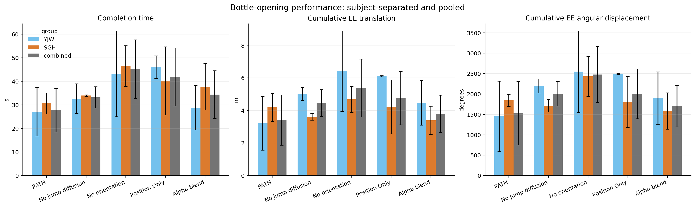
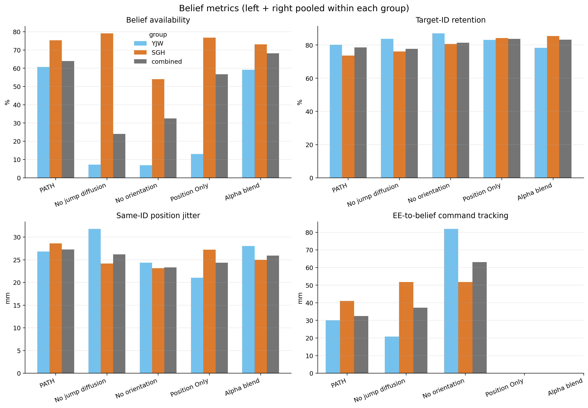

# Bottle-open ablation analysis by subject

Each matched CSV/summary pair is an independent trial. Trial-number suffixes are not matched or compared across methods/subjects. Primary tables exclude incomplete pairs.

## Performance metrics by subject and pooled

| method | group | n | time mean (s) | EE distance mean (m) | EE angle mean (deg) |
| --- | --- | --- | --- | --- | --- |
| PATH | YJW | 8 | 27.08 | 3.214 | 1451.9 |
| PATH | SGH | 2 | 30.63 | 4.194 | 1847.2 |
| PATH | combined | 10 | 27.79 | 3.410 | 1530.9 |
| No jump diffusion | YJW | 3 | 32.70 | 5.015 | 2198.2 |
| No jump diffusion | SGH | 2 | 33.99 | 3.608 | 1716.5 |
| No jump diffusion | combined | 5 | 33.22 | 4.452 | 2005.5 |
| No orientation | YJW | 4 | 43.19 | 6.413 | 2548.4 |
| No orientation | SGH | 6 | 46.54 | 4.681 | 2430.6 |
| No orientation | combined | 10 | 45.20 | 5.374 | 2477.7 |
| Position Only | YJW | 2 | 46.05 | 6.105 | 2490.8 |
| Position Only | SGH | 5 | 40.24 | 4.221 | 1808.2 |
| Position Only | combined | 7 | 41.90 | 4.759 | 2003.2 |
| Alpha blend | YJW | 3 | 28.84 | 4.483 | 1903.5 |
| Alpha blend | SGH | 5 | 37.75 | 3.391 | 1583.9 |
| Alpha blend | combined | 8 | 34.41 | 3.800 | 1703.7 |

## Belief metrics (complete pairs)

## Ablation change versus PATH

| method | group | time Δ (s) | time Δ (%) | distance Δ (m) | distance Δ (%) | angle Δ (deg) | angle Δ (%) |
| --- | --- | --- | --- | --- | --- | --- | --- |
| PATH | YJW | 0.00 | 0.0 | 0.000 | 0.0 | 0.0 | 0.0 |
| No jump diffusion | YJW | 5.62 | 20.7 | 1.801 | 56.0 | 746.3 | 51.4 |
| No orientation | YJW | 16.11 | 59.5 | 3.199 | 99.5 | 1096.5 | 75.5 |
| Position Only | YJW | 18.97 | 70.0 | 2.891 | 90.0 | 1038.9 | 71.6 |
| Alpha blend | YJW | 1.76 | 6.5 | 1.269 | 39.5 | 451.6 | 31.1 |
| PATH | SGH | 0.00 | 0.0 | 0.000 | 0.0 | 0.0 | 0.0 |
| No jump diffusion | SGH | 3.36 | 11.0 | -0.586 | -14.0 | -130.7 | -7.1 |
| No orientation | SGH | 15.91 | 51.9 | 0.487 | 11.6 | 583.5 | 31.6 |
| Position Only | SGH | 9.61 | 31.4 | 0.027 | 0.6 | -39.0 | -2.1 |
| Alpha blend | SGH | 7.12 | 23.2 | -0.803 | -19.2 | -263.3 | -14.3 |
| PATH | combined | 0.00 | 0.0 | 0.000 | 0.0 | 0.0 | 0.0 |
| No jump diffusion | combined | 5.42 | 19.5 | 1.042 | 30.6 | 474.5 | 31.0 |
| No orientation | combined | 17.41 | 62.6 | 1.964 | 57.6 | 946.8 | 61.8 |
| Position Only | combined | 14.11 | 50.8 | 1.349 | 39.6 | 472.3 | 30.9 |
| Alpha blend | combined | 6.62 | 23.8 | 0.390 | 11.4 | 172.8 | 11.3 |

## Belief metrics (complete pairs)

| method | group | availability (%) | ID retention (%) | jitter RMSE (mm) | tracking RMSE (mm) |
| --- | --- | --- | --- | --- | --- |
| PATH | YJW | 60.8 | 80.2 | 26.82 | 30.10 |
| PATH | SGH | 75.4 | 73.6 | 28.63 | 40.98 |
| PATH | combined | 63.9 | 78.5 | 27.27 | 32.52 |
| No jump diffusion | YJW | 7.2 | 83.7 | 31.80 | 20.81 |
| No jump diffusion | SGH | 79.1 | 76.1 | 24.16 | 51.72 |
| No jump diffusion | combined | 24.0 | 77.8 | 26.17 | 37.23 |
| No orientation | YJW | 6.9 | 87.0 | 24.36 | 81.92 |
| No orientation | SGH | 54.1 | 80.7 | 23.15 | 51.81 |
| No orientation | combined | 32.5 | 81.4 | 23.31 | 63.10 |
| Position Only | YJW | 13.0 | 83.1 | 21.03 | N/A |
| Position Only | SGH | 76.7 | 84.3 | 27.22 | N/A |
| Position Only | combined | 56.7 | 83.7 | 24.36 | N/A |
| Alpha blend | YJW | 59.1 | 78.3 | 28.04 | N/A |
| Alpha blend | SGH | 73.1 | 85.4 | 25.00 | N/A |
| Alpha blend | combined | 68.1 | 83.2 | 25.92 | N/A |

Detailed left/right/combined belief metrics are in `belief_metrics_by_method_person_hand.csv`.
